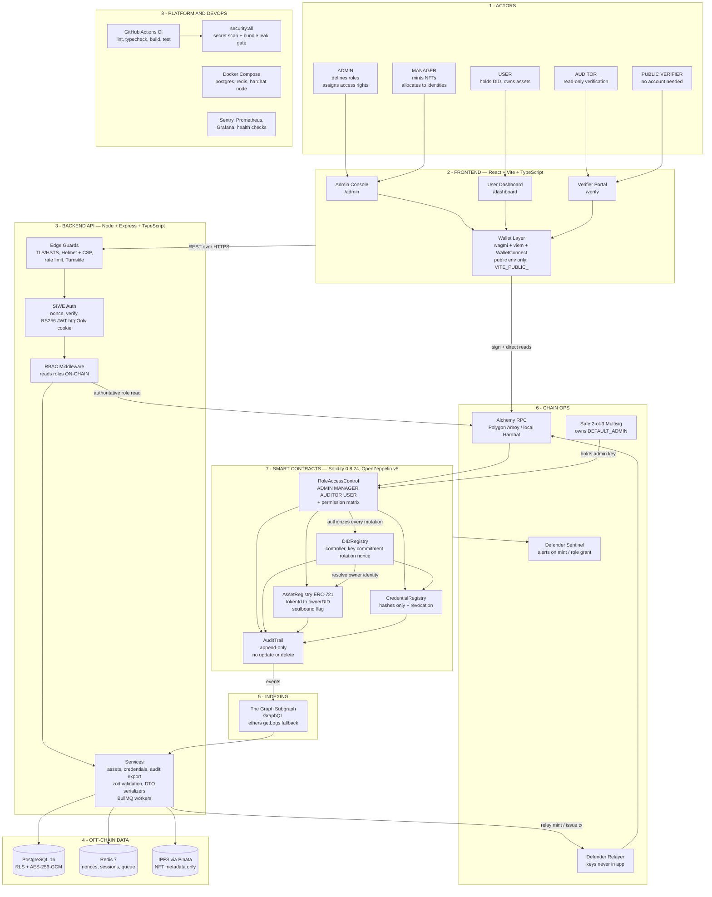

# System Architecture — TrustChain (SIH-26)

Layered block diagram. Each numbered band is one layer; arrows show what talks
to what.

## Block reference

| Block                | Where it lives                 | Notes                                         |
| -------------------- | ------------------------------ | --------------------------------------------- |
| Frontend             | `packages/frontend`            | Public env only, enforced by Vite `envPrefix` |
| Backend API          | `packages/backend`             | Fail-fast zod env, on-chain role reads        |
| Contracts            | `packages/contracts/contracts` | Five contracts, roles per problem statement   |
| Local infrastructure | `docker-compose.yml`           | postgres:16, redis:7, Hardhat node            |
| CI + security gates  | `.github/workflows`, `tools/`  | Secret scan, bundle leak check, full test run |

## Design rules the diagram encodes

1. **The contract is the authority.** The backend can propose a transaction; it can never override an on-chain role check. A fully compromised API still cannot mint.
2. **Roles are read on-chain at authentication**, never trusted from a JWT claim.
3. **No PII on-chain** — identities are hashes and key commitments; credentials are hashes only.
4. **The audit trail is append-only** and exposes no update or delete function.
5. **Secrets never cross into the browser** — the frontend only ever sees `VITE_PUBLIC_*`.
6. **Admin keys live in a multisig**, not an EOA.
